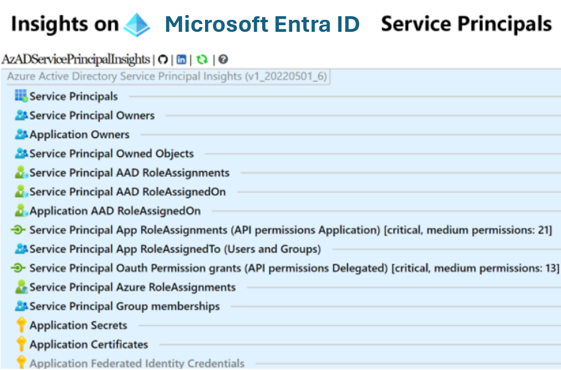

# AzADServicePrincipalInsights (AzADSPI)

[](https://scorecard.dev/viewer/?uri=github.com/JulianHayward/AzADServicePrincipalInsights)
[](https://github.com/JulianHayward/AzADServicePrincipalInsights/actions/workflows/pester.yml)
[](https://github.com/JulianHayward/AzADServicePrincipalInsights/actions/workflows/psScriptAnalyzer.yml)
[](https://github.com/JulianHayward/AzADServicePrincipalInsights/actions/workflows/zizmor.yml)
[](https://learn.microsoft.com/powershell/scripting/install/installing-powershell)
[](LICENSE)

Insights and change tracking for Microsoft Entra ID service principals: enterprise applications, app registrations and managed identities.

AzADServicePrincipalInsights is a PowerShell script. It reads Microsoft Graph and Azure Resource Manager and shows, for every service principal:
- what it can do (Entra roles, app permissions, delegated permissions, Azure roles)
- who controls it (owners, credentials, federated identity credentials)
- which of that is risky

It writes an HTML report, CSV and JSON files. Run on a schedule in Azure DevOps or GitHub Actions, it also records what changed between runs.

Short links: [aka.ms/AzADSPI](https://aka.ms/AzADSPI) · [aka.ms/AzADServicePrincipalInsights](https://aka.ms/AzADServicePrincipalInsights)



## Contents

- [Features](#features)
- [Quick start](#quick-start)
- [Setup](#setup)
- [Prerequisites](#prerequisites)
- [Parameters](#parameters)
- [Output](#output)
- [Azure DevOps and GitHub Actions](#azure-devops-and-github-actions)
- [Change history](#change-history)
- [Permission classification](#permission-classification)
- [Telemetry](#telemetry)
- [Security](#security)
- [Updates](#updates)
- [Contributing](#contributing)
- [Related projects](#related-projects)
- [License and disclaimer](#license-and-disclaimer)

## Features

**Report (HTML)**
- **Look:** Azure portal style, with pages: Overview, Service Principals, Ownership, Entra roles, API permissions, Azure RBAC, Groups, Credentials, Managed identities, Risk, High-privilege users, Optional data.
- **Navigation:** navigation pane, search (`/`), deep links (`#<section>`), light and dark theme, run parameters dialog.
- **Tables (AG Grid):** filters, column chooser, CSV download, pop-out window.
- **Findings overview:** key figures and one tile per finding, linking to the sections.
- **Links:** to the Microsoft Entra and Azure portal pages of the objects, and to [AzAdvertizer](https://www.azadvertizer.net) for roles, permissions and resource types.

**Insights derived from the collected data**
- **Effective privilege per service principal (critical / high):**
  - privileged Entra roles, also through role-assignable groups
  - app roles that allow privilege escalation
  - critical data access
  - admin-consented critical delegated permissions
  - critical Azure roles, also limited by role conditions
  - control through ownership of other service principals and apps
- **Credential risk of privileged service principals:** secrets, long-lived credentials, credentials on the service principal.
- **Credentials on the service principal itself:** not visible in the app registration.
- **Multi-tenant apps of other organizations with sensitive permissions:** publisher verified or not.
- **Cleanup candidates:** disabled service principals with permissions, managed identities of deleted resources, privileged apps without an owner, expired credentials.
- **Application configuration findings:** redirect URIs without https, wildcards, Azure-hosted domains, implicit grant, public client flows.
- **Federated identity credentials, who can sign in:**
  - GitHub repository, branch or environment; Azure DevOps service connection; AKS service account; custom issuers
  - credentials that still use the deprecated Azure DevOps issuer (retirement 2027-07-01)
- **User-assigned managed identities:** associated Azure resources, assignment restrictions (preview) and isolation scope.
- **High-privilege (HiPo) users:** owners of privileged service principals and apps.
- **Agent objects:** Microsoft Entra Agent ID.
- **Optional, with the [optional permissions](#microsoft-entra-id):** Entra recommendations for applications, custom security attributes, tenant consent settings.

**Change history**
- What changed since the previous runs: objects, permissions, roles, credentials, owners, configuration. See [Change history](#change-history).

**Output and automation**
- **Files:** CSV (one file per report table) and JSON (one file per object).
- **Pipelines:** Azure DevOps pipeline and GitHub Actions workflows run on a schedule and push the output to the repository.
- **Optional:** publishing to an Azure Web App that requires a login, and ingestion into a Log Analytics custom table.

## Quick start

From the console, as a user with **Reader** on the management group:

```powershell
Install-Module -Name Az.Accounts
Connect-AzAccount -TenantId <tenantId>

#the script needs only two files in one folder (no Git needed)
New-Item -ItemType Directory -Force -Path "$HOME/AzADSPI" | Out-Null
Set-Location "$HOME/AzADSPI"
foreach ($file in 'AzADServicePrincipalInsights.ps1', 'permissionClassification.json') {
    Invoke-WebRequest -Uri "https://raw.githubusercontent.com/JulianHayward/AzADServicePrincipalInsights/main/pwsh/$file" -OutFile $file
}
./AzADServicePrincipalInsights.ps1 -ManagementGroupId <managementGroupId> -OutputPath ./output
```

Or clone the repository (`git clone https://github.com/JulianHayward/AzADServicePrincipalInsights.git`) and run `./pwsh/AzADServicePrincipalInsights.ps1`. Open the `.html` file in the output folder. The script offers to install the AzAPICall module if it is missing. Step by step, with checks and troubleshooting: [setup/console.md](setup/console.md).

As a service principal (USER: the Application (client) ID, PASSWORD: the client secret):

```powershell
$credential = Get-Credential
Connect-AzAccount -ServicePrincipal -TenantId <tenantId> -Credential $credential
./AzADServicePrincipalInsights.ps1 -ManagementGroupId <managementGroupId> -OutputPath ./output
```

## Setup

Step-by-step guides in [setup](setup/README.md). Each guide lists who you need, has a checkpoint after every step and a troubleshooting table. Not sure where to start? The [setup assistant](https://www.azadvertizer.net/azadserviceprincipalinsights/setup-assistant.html) asks a few questions and gives you the steps for your setup:

| Guide | When |
|---|---|
| [Console](setup/console.md) | One-off runs from your computer or a GitHub Codespace |
| [GitHub Actions](setup/github.md) | Scheduled runs in a private repository (workload identity federation or client secret) |
| [Azure DevOps](setup/azure-devops.md) | Scheduled runs with a workload identity federation service connection |
| [Azure Web App](setup/azure-web-app.md) | Optional: publish the report to a Web App that only the members of a group can open (setup script or ARM template) |
| [Log Analytics](setup/log-analytics.md) | Optional: send the JSON output to a Log Analytics custom table (ARM template for the table and the Data Collection Rule) |

## Prerequisites

### PowerShell

- **PowerShell 7.0.3 or later.** Windows PowerShell 5.1 is not supported.
- **Az.Accounts module**, for the sign-in.
- **AzAPICall module** ([PowerShell Gallery](https://www.powershellgallery.com/packages/AzAPICall), [GitHub](https://aka.ms/AzAPICall)), in the version of the parameter `-azAPICallVersion`. In Azure DevOps and GitHub Actions it is installed automatically. In the console, the script offers to install it.

### Permissions

#### Azure

**Reader** on the management group you run it for (`-ManagementGroupId`; default: the Tenant Root Group).

#### Microsoft Entra ID

Microsoft Graph application permissions (for a service principal or managed identity, with admin consent):

| Permission | |
|---|---|
| Application.Read.All | required |
| Group.Read.All | required |
| RoleManagement.Read.Directory | required |
| User.Read.All | required |
| DelegatedPermissionGrant.Read.All | optional: the delegated permission grants are read once for the tenant instead of once per service principal (faster; the output is the same) |
| DirectoryRecommendations.Read.All | optional: the active Microsoft Entra recommendations for applications per service principal (report section, `_ServicePrincipalsEntraRecommendations.csv`, JSON `SPEntraRecommendations`) |
| CustomSecAttributeAssignment.Read.All | optional: the custom security attributes of service principals (report section, `_ServicePrincipalsCustomSecurityAttributes.csv`, JSON `SPCustomSecurityAttributes`) |
| Policy.Read.All and Policy.Read.PermissionGrant | optional: the tenant consent settings (report section, `_TenantConsentSettings.csv`) |

The script tests the optional permissions at the start. Without them, that data is not collected: the JSON property is missing and the report section says so.

As a user: a member user can read most of the data with the default user permissions, and a Global Reader all of it (custom security attributes: Attribute Assignment Reader). How to grant the permissions, also to a managed identity: [setup](setup/README.md#permissions).

#### Azure DevOps

The build service account (**&lt;project&gt; Build Service (&lt;organization&gt;)** or **Project Collection Build Service (&lt;organization&gt;)**) needs **Contribute** on the repository, to push the output. Steps: [setup/azure-devops.md](setup/azure-devops.md#step-4---allow-the-pipeline-to-save-the-output-in-the-repository).

## Parameters

| Parameter | Type (default) | Description |
|---|---|---|
| `ManagementGroupId` | string[] (Tenant Root Group) | The management group ID(s) to process, e.g. `-ManagementGroupId @('mgId0', 'mgId1')`; pipelines/workflows: comma separated `mgId0,mgId1` |
| `SubscriptionQuotaIdWhitelist` | array (all) | Process only subscriptions whose QuotaId starts with one of the values, e.g. `-SubscriptionQuotaIdWhitelist MSDN_,EnterpriseAgreement_` |
| `NoAzureResourceSideRelations` | switch | Do not process the Azure resource side (Azure role assignments, policy assignments, resources and managed identity resources) |
| `OnlyProcessSPsThatHaveARoleAssignmentInTheRelevantMGScopes` | switch | Report only service principals that have an Azure role assignment within the scope of the run |
| `CriticalAADRoles` | array (Global Administrator, Privileged Role Administrator, Privileged Authentication Administrator) | Entra role definition IDs treated as critical **in addition to** the roles Microsoft marks as privileged (`isPrivileged`), e.g. custom roles. Role assignments through role-assignable groups are included (`indirect`) |
| `ApplicationSecretExpiryWarning` | int (14) | Warning period (days) for secret expiry |
| `ApplicationSecretExpiryMax` | int (730) | Maximum lifetime (days) for secrets |
| `ApplicationCertificateExpiryWarning` | int (14) | Warning period (days) for certificate expiry |
| `ApplicationCertificateExpiryMax` | int (730) | Maximum lifetime (days) for certificates |
| `OutputPath` | string (current directory) | Folder for the output files |
| `NoCsvExport` | switch | Do not write CSV files |
| `CsvDelimiter` | `;` or `,` (`;`) | CSV delimiter |
| `CsvExportUseQuotesAsNeeded` | switch | Quote CSV values only where needed (default: all values are quoted) |
| `NoJsonExport` | switch | Do not write JSON files (needed for the Log Analytics ingestion) |
| `FileTimeStampFormat` | string (`yyyyMMdd_HHmmss`) | Time format of the output file names (console runs; pipelines/workflows write names without timestamp) |
| `NoChangeHistory` | switch | Do not record the [change history](#change-history) (on by default) |
| `ChangeHistoryDays` | int 1-3650 (30) | Period of the report page 'Changes'; the history file itself is kept without time limit |
| `ThrottleLimitARM` | int 1-1000 (10) | Parallel Azure Resource Manager requests |
| `ThrottleLimitGraph` | int 1-1000 (25) | Parallel Microsoft Graph requests |
| `ThrottleLimitLocal` | int 1-1000 (100) | Parallelism of the local processing |
| `SubscriptionId4AzContext` | string | Subscription used as Azure context by AzAPICall |
| `StatsOptOut` | switch | Send only an anonymous run count instead of the usage statistics ([Telemetry](#telemetry)) |
| `DoTranscript` | switch | Write a transcript of the console output to the output folder |
| `PerfTracking` | switch | Processing times per service principal (console totals and `_perf.csv`) and API calls per task |
| `DebugAzAPICall` | switch | AzAPICall debug output, for troubleshooting API calls |
| `AzAPICallModuleName` | `AzAPICall` or `AzAPICallBeta` (`AzAPICall`) | The AzAPICall module to use |
| `azAPICallVersion` | string | The AzAPICall version to use (the default is the tested version) |
| `ScriptPath` | string (`pwsh`) | Folder of the script, relative to the working directory (pipelines/workflows; also where `permissionClassification.json` is looked for) |
| `DirectorySeparatorChar` | string (OS default) | Directory separator |

Pipelines and workflows set the parameters in a variables file: see [Azure DevOps and GitHub Actions](#azure-devops-and-github-actions).

## Output

Files in the output folder (`<ref>`: the management group IDs; console runs add the version and a timestamp):

| File | Content |
|---|---|
| `AzADServicePrincipalInsights_<ref>.html` | The report |
| `AzADServicePrincipalInsights_<ref>_<table>.csv` | One CSV per report table, e.g. `_ServicePrincipals`, `_ServicePrincipalOwners`, `_AppRoleAssignments_`, `_Oauth2PermissionGrants_`, `_ServicePrincipalsAzureRoleAssignments`, `_ServicePrincipalEffectivePrivilege`, `_FederatedIdentityCredentialTrust`, `_ChangeHistory` |
| `JSON_SP_<ref>/` | One JSON file per service principal, application or managed identity, with all collected and derived data |
| `AzADServicePrincipalInsights_<ref>_ChangeHistory.jsonl`, `..._ChangeHistoryState.json` | The [change history](#change-history) and the state for the next comparison |

The output contains insights about your tenant: who has which permissions and credentials. Store it like other sensitive data, see [Security](#security).

Data collected:
- **Service principals and applications:** service principals by type; service principal and application owners; objects owned by service principals.
- **Roles:** Entra role assignments of service principals (direct and through role-assignable groups); Entra roles assigned on service principals and on applications; Azure role assignments of service principals (management groups, subscriptions, resource groups, resources), with role conditions.
- **Permissions:** application permissions (app role assignments); users and groups assigned to applications; delegated permissions (OAuth2 permission grants, with consent type).
- **Groups:** group memberships of service principals.
- **Credentials:** application and service principal secrets and certificates; federated identity credentials of applications and of user-assigned managed identities.
- **User-assigned managed identities:** associated Azure resources, assignment restrictions and isolation scope, with a suggestion that keeps the existing attachments working ([Microsoft docs](https://learn.microsoft.com/entra/identity/managed-identities-azure-resources/managed-identities-assignment-restriction)).
- **High-privilege (HiPo) users.**

The column, property and file names are stable. New versions add columns and files; they do not rename or remove them.

## Azure DevOps and GitHub Actions

The script parameters are set in a variables file, one entry per parameter, with the same names and layout on both platforms:
- Azure DevOps: [.azuredevops/pipelines/AzADServicePrincipalInsights.variables.yml](.azuredevops/pipelines/AzADServicePrincipalInsights.variables.yml). This is the variables template of the pipeline. Variables from variable groups or the pipeline UI with the name of a parameter are used too; secret variables are not visible to the step.
- GitHub Actions: [.github/AzADServicePrincipalInsights.variables.yml](.github/AzADServicePrincipalInsights.variables.yml).

Both files start with the settings of the pipeline/workflow - Azure DevOps: section 'Pipeline' (`ServiceConnection`, `ScriptDir`); GitHub: section 'Workflow' (`ScriptDir`). From there on they have the same content: the required parameters, the optional ones (grouped), then the optional features with their switch first - sections 'Log Analytics ingestion' and 'Web App publishing'. The pipeline/workflow file keeps the schedule; on GitHub also the sign-in and the path of the variables file (`env`).

**Values**
- Each entry documents its type, default and an example.
- An empty value means "not set" (the script default applies).
- Values are plain text: a switch is `true`/`false`, a list is comma separated (`mgId0,mgId1`).
- `ManagementGroupId` and `OutputPath` are required. An empty `ManagementGroupId` means the Tenant Root Group.

**How the values reach the scripts**
- The step 'Create arguments' ([pwsh/New-AzADSPIArgumentFile.ps1](pwsh/New-AzADSPIArgumentFile.ps1)) converts the values to the parameter types and checks them: template placeholders, switch values, integers, allowed values and ranges, unknown variables. The rules per script are in `pwsh/<script>.arguments.psd1`.
- The run steps read the arguments file ([pwsh/Read-AzADSPIArgumentFile.ps1](pwsh/Read-AzADSPIArgumentFile.ps1)) and pass the parameters to the script by splatting, so a value is never part of a script text.
- The same mechanism provides the arguments of the Log Analytics ingestion ([pwsh/Send-AzADSPILogAnalyticsData.ps1](pwsh/Send-AzADSPILogAnalyticsData.ps1)). The pipeline or workflow sets the JSON folder of the run.

**Pushing the output:** the step 'Push AzADServicePrincipalInsights output to repository' ([pwsh/Push-AzADSPIOutput.ps1](pwsh/Push-AzADSPIOutput.ps1), the same script on both platforms) commits only when the output changed, sets the git identity for the repository only, rebases on a run that pushed in the meantime, and then pushes to the branch of the run.

**Web App publishing:** [pwsh/Publish-AzADSPIWebApp.ps1](pwsh/Publish-AzADSPIWebApp.ps1) publishes only to a Web App that requires a login (App Service Authentication v1 or v2, unauthenticated requests not allowed).

**Runs must not overlap.** They change the same output files (report, CSVs, change history), so a second run could not push its output.
- **GitHub:** the workflows of a branch wait for each other (`concurrency` group). A waiting run is not cancelled; GitHub keeps one waiting run, and a newer one replaces it. A waiting run checks out the head of the branch when it starts.
- **Azure DevOps:** a pipeline has no such setting. Keep the schedule and manual runs apart, or add an exclusive lock check to a resource of the pipeline. The pipeline fetches the current head of the branch before the run, so a run that waited works on the output of the previous one.
- **Either way,** an overlapping run stops in the push step with a clear message. Run it again.

**Migrating from an earlier pipeline/workflow:** move your values into the variables file. Parameters that were added to the run line by hand are set in the variables file now.
- **Azure DevOps:** the `managementGroupIds` / `subscriptionQuotaIdWhitelistParameters` parameters and the `variables` block of the pipeline become `ManagementGroupId` / `SubscriptionQuotaIdWhitelist` (comma separated) and the other entries of `AzADServicePrincipalInsights.variables.yml`; `ServiceConnection` and `ScriptDir` are in its section 'Pipeline'.
- **GitHub:** `ManagementGroups_s` / `OutputPath` / `WebAppPublish`, `IngestToLogAnalytics` and the `WebApp*` values / the Data Collection Rule values of the workflow `env` become `ManagementGroupId` / `OutputPath` / the entries of the sections 'Web App publishing' and 'Log Analytics ingestion' of `.github/AzADServicePrincipalInsights.variables.yml`. `ScriptDir` moves to its section 'Workflow'; the workflow's `env` keeps only `VariablesFile`.

## Change history

Every run compares its result with the previous run in the same output folder (same tenant and scope).
- **History file:** the changes are appended to `AzADServicePrincipalInsights_<scope>_ChangeHistory.jsonl`, one JSON line per change, kept without time limit.
- **State file:** the state for the next comparison is `AzADServicePrincipalInsights_<scope>_ChangeHistoryState.json`. `<scope>` is the management group IDs, as in the other file names.
- **Report:** the page 'Changes' shows the changes of the last `-ChangeHistoryDays` days (default 30), with a tile in the findings overview and the CSV `_ChangeHistory.csv`.
- **Pipelines/workflows:** both files are in the output folder and are pushed with the report, so the history continues from run to run.
- `-NoChangeHistory` switches it off.

Recorded (compared by ID):
- **Security:** service principals and applications added or removed, effective privilege changed, Entra roles, critical Azure roles (also their conditions), application permissions, delegated permissions, credentials (secrets and certificates of the application and of the service principal), federated identity credentials (also changed issuer/subject), direct owners.
- **Configuration:** renamed, enabled/disabled, sign-in audience, redirect URIs, identifier URIs, group memberships.

Not recorded, because it is noise:
- Microsoft first-party apps appearing or disappearing (Microsoft adds them).
- Certificates of managed identities (Azure rotates them).
- Azure roles that are not critical (deployments create and remove them).
- Indirect owners and roles through groups (they follow from the recorded changes and show in the effective privilege).
- The expiry status of credentials (time, not a change).

Items are compared by their IDs, not by labels such as the sensitivity of a permission. A new script version with another classification does not produce changes; only a changed effective privilege level gets the note 'script version changed'.

Guards against false changes:
- **First run in an output folder:** 'baseline created', no changes.
- **Another scope than the previous run** (tenant, management groups, `SubscriptionQuotaIdWhitelist`, `NoAzureResourceSideRelations`, `OnlyProcessSPsThatHaveARoleAssignmentInTheRelevantMGScopes`): 'baseline reset' with the reason, no comparison.
- **A run with collection errors:** the objects whose collection failed or is incomplete keep their previous state. No change is reported for them, and they are not 'removed'.
  - A failed management group or subscription keeps the Azure roles and the effective privilege of all objects. A failed group resolution keeps the group memberships.
  - The next complete run reports these changes, and the run record names what was not compared.
- **An unreadable state file,** a state file with unexpected content or another state format: 'baseline reset'.
- **An unreadable line in the log** (hand or merge edit) is skipped and counted, with a note in the report. It never stops the report.

## Permission classification

Application and delegated permissions are classified as critical or medium by [pwsh/permissionClassification.json](pwsh/permissionClassification.json). The classification marks permissions in the report and the CSVs, and feeds the effective privilege ('critical data access', admin-consented critical delegated permissions). You can adapt the file to your own classification.

App roles that allow privilege escalation (e.g. `RoleManagement.ReadWrite.Directory`, `AppRoleAssignment.ReadWrite.All`) are critical regardless of the file.

Sources:
- [Everything about service principals, applications and API permissions](https://m365internals.com/2021/07/24/everything-about-service-principals-applications-and-api-permissions/): what applications are considered critical?
- [App consent grant investigation: classifying risky permissions](https://docs.microsoft.com/en-us/security/compass/incident-response-playbook-app-consent#classifying-risky-permissions)
- [Monitoring and Incident Response in Azure AD](https://www.youtube.com/watch?v=T-ZnAUt1IP8)

## Telemetry

At the end of a run the script sends one event to Azure Application Insights (`dc.services.visualstudio.com`). These are usage statistics for the maintainer: how many tenants use AzADServicePrincipalInsights, with which versions and on which platforms.

- **By default:** the identifier (see below), the product, PowerShell and Az.Accounts versions, the Azure cloud, the platform (e.g. Console, AzureDevOps, GitHubActions), the account type (e.g. user, service principal, managed identity), size buckets (fewer/more than 100 subscriptions, fewer/more than 1,000 service principals) and the error count.
- **With `-StatsOptOut`:** only a random ID. That is a run count, not linked to the tenant, the account or another run.

No tenant data is sent: no names, no object IDs, no report content, nothing about the signed-in account except its type. Application Insights derives a coarse location (country, city) from the sender's IP address; it does not store the IP address.

**The identifier** is the SHA-256 hash of the product name and the tenant ID (`AzADServicePrincipalInsights|<tenantId>`, 64 hex characters).
- It is one value per tenant, whoever runs the script, so unique tenants can be counted.
- It contains nothing about the account or the user who runs the script.

The tenant ID cannot be read out of it:
- SHA-256 is a one-way function: the input cannot be calculated from the hash.
- Trying all possible tenant IDs is not feasible either: a tenant ID is a random GUID with 122 random bits, about 5 × 10<sup>36</sup> possible values.

The only thing someone with access to the statistics (the maintainer) could do is take a tenant ID they already know, calculate its hash and see whether it occurs. Tenant IDs are not secret; they can be looked up for a domain. A match confirms that this tenant ran AzADServicePrincipalInsights. It reveals no tenant data and nothing about a person.

## Security

The output describes who can do what in your tenant: privileged service principals, their owners and their credentials (not the secrets themselves). The automation protects it:
- **GitHub repository:** the workflows stop when the repository is public.
- **Web App:** the publishing step stops when the Web App can be opened without a login.
- **Identity:** it only reads Azure and Microsoft Graph.

Keep the repository, the Web App and Log Analytics access as restricted as the data they hold.

Please report a vulnerability in AzADServicePrincipalInsights privately, not in a public issue: see [SECURITY.md](SECURITY.md).

## Updates

See [CHANGELOG.md](CHANGELOG.md). Version 2 (`v2_20261111_0`) changes the setup of the Azure DevOps pipeline and the GitHub workflows (variables file): see [Migrating](#azure-devops-and-github-actions).

## Contributing

Issues and pull requests are welcome. Please read [CONTRIBUTING.md](CONTRIBUTING.md) first: how to set up, test and submit a change, and the rules for the output (no renamed columns, no tenant data). Bug reports: use the [issue template](https://github.com/JulianHayward/AzADServicePrincipalInsights/issues/new/choose).

## Related projects

- [AzAPICall](https://aka.ms/AzAPICall): the PowerShell module AzADServicePrincipalInsights uses for Microsoft Graph and Azure Resource Manager requests.
- [AzAdvertizer](https://www.azadvertizer.net): overview of, and insights on, new releases and changes for Azure governance capabilities. It covers Azure Policy definitions, initiatives and aliases, Azure RBAC role definitions, resource provider operations, and Microsoft Entra roles and API permissions.
- [Azure Governance Visualizer (AzGovViz)](https://aka.ms/AzGovViz): a holistic overview of your Azure governance implementation. It covers the management group hierarchy down to subscriptions, Azure Policy, RBAC and more. It is listed as a [tool](https://docs.microsoft.com/en-us/azure/cloud-adoption-framework/reference/tools-templates#govern) in the Microsoft Cloud Adoption Framework.

## License and disclaimer

[MIT](LICENSE).

AzADServicePrincipalInsights is developed by a Microsoft employee, but it is not a Microsoft service or product. It is a personal, community-driven project. There are no implicit or explicit obligations related to this project; it is provided 'as is' with no warranties and confers no rights.
