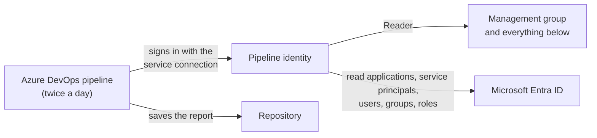

# Run AzADServicePrincipalInsights from Azure DevOps

An Azure DevOps pipeline runs AzADServicePrincipalInsights twice a day and saves the report in the repository. The pipeline signs in with a service connection - no password or secret to store or renew - and only gets read access.

> **Already running AzADServicePrincipalInsights in Azure DevOps?** Service connections with workload identity federation must be converted before **July 1, 2027** - see [Convert an existing service connection](#convert-an-existing-service-connection).

## What you will end up with

| Component | What it is for |
|---|---|
| **Azure DevOps project** (private) | Holds the repository and the pipeline. |
| **Pipeline identity** (app registration or managed identity) | The account the pipeline runs as. It gets read access only. |
| **Service connection** | Connects the pipeline to the pipeline identity. |
| **Pipeline** | Runs AzADServicePrincipalInsights and saves the report, the CSV and JSON files and the change history in the repository. |

## Before you start

The Microsoft Entra steps are described in the [Azure portal](https://portal.azure.com) (**Microsoft Entra ID**). The [Microsoft Entra admin center](https://entra.microsoft.com/) has the same pages, if you prefer it.

### Who you need

| Steps | Role |
|---|---|
| 1, 2, 4, 5 | **Project Administrator** of the Azure DevOps project (or the right to create projects) |
| 2 | '**Owner**' or '**User Access Administrator**' of the management group - for the '**Reader**' role assignment |
| 2 (option A) | Permission to create app registrations in Microsoft Entra ID |
| 3 | '**Privileged Role Administrator**' or '**Global Administrator**' in Microsoft Entra ID |

### Choose the pipeline identity

| Your situation | Choose |
|---|---|
| Most setups | **Option A** - app registration, created by you (recommended) |
| You want it quick, and you are '**Owner**' of the management group | **Option B** - app registration, created by Azure DevOps |
| You may not create app registrations | **Option C** - managed identity |

## Step 1 - Create the project and import the code

1. [Create an Azure DevOps project](https://learn.microsoft.com/azure/devops/organizations/projects/create-project#create-a-project) with visibility **Private**. The report contains insights about your tenant. You can also use an existing private project.
1. In the project: **Repos** > **Import repository** > clone URL `https://github.com/JulianHayward/AzADServicePrincipalInsights.git` > **Import** ([details](https://learn.microsoft.com/azure/devops/repos/git/import-git-repository#import-into-a-new-repo)). No sign-in is needed, the repository is public.

> **Checkpoint 1:** the project is private, and **Repos** shows the files of AzADServicePrincipalInsights.

## Step 2 - Create the pipeline identity and the service connection

Note the **management group ID** first: Azure portal > **Management groups** > your management group (usually the **Tenant Root Group**) > **ID** on the overview page - not the display name.

Then follow your option.

### Option A - App registration, created by you

**1. Create the app registration**

1. [Azure portal](https://portal.azure.com) > **Microsoft Entra ID** > **App registrations** > **New registration**
1. Name, e.g. `AzADServicePrincipalInsights_SC`; keep **Accounts in this organizational directory only** (other account types don't work) > **Register**
1. Note the **Application (client) ID** and the **Directory (tenant) ID**

**2. Give it the '**Reader**' role**

[Azure portal](https://portal.azure.com) > **Management groups** > your management group > **Access control (IAM)** > **Add** > **Add role assignment** > '**Reader**' > **Next** > **Select members** > the app registration > **Review + assign**

**3. Start the service connection** ([Azure DevOps](https://dev.azure.com/) > your project)

1. **Project settings** (bottom left) > **Service connections** > **New service connection** > **Azure Resource Manager** > **Next**
1. Identity type **App registration or managed identity (manual)**, credential **Workload identity federation**
1. **Step 1: Basics** - a name for the service connection (e.g. `AzADServicePrincipalInsights`), environment **Azure Cloud**, the **Directory (tenant) ID** > **Next**
1. **Step 2** - scope level **Management Group** with the management group ID and name; the **Application (client) ID**; leave **Grant access permission to all pipelines** unchecked
1. Copy the values **Issuer** and **Subject identifier**
1. **Keep as draft**

**4. Connect the app registration to Azure DevOps**

1. Azure portal > **Microsoft Entra ID** > your app registration > **Certificates & secrets** > **Federated credentials** > **Add credential**
1. Scenario **Other issuer**; paste the **Issuer** and the **Subject identifier** (if a type is offered: **Explicit subject identifier**); a name, e.g. `AzADServicePrincipalInsights_AzDO`; keep the audience `api://AzureADTokenExchange` > **Add**

**5. Finish the service connection**

Azure DevOps > **Project settings** > **Service connections** > your draft > **Finish setup** > **Verify and save**

### Option B - App registration, created by Azure DevOps

1. [Azure DevOps](https://dev.azure.com/) > your project > **Project settings** > **Service connections** > **New service connection** > **Azure Resource Manager** > **Next**
1. Identity type **App registration (automatic)**, credential **Workload identity federation**
1. Scope level **Management Group**, select your management group; a name for the service connection (e.g. `AzADServicePrincipalInsights`); leave **Grant access permission to all pipelines** unchecked > **Save**

Azure DevOps gives the new identity more rights than needed. Reduce them to '**Reader**':

1. Azure portal > **Management groups** > your management group > **Access control (IAM)** > **Role assignments** - find the role assignment of the new app registration (to see its name, open the service connection in Azure DevOps - it links to the app registration)
1. **Add** > **Add role assignment** > '**Reader**' for the same app registration
1. Remove the role assignment that Azure DevOps created

### Option C - Managed identity

1. [Create a user-assigned managed identity](https://learn.microsoft.com/entra/identity/managed-identities-azure-resources/how-manage-user-assigned-managed-identities?pivots=identity-mi-methods-azp#create-a-user-assigned-managed-identity) in any resource group (needs '**Managed Identity Contributor**' on the resource group). Note its **Object (principal) ID**.
1. Give it the '**Reader**' role on the management group (as in option A, part 2).
1. [Azure DevOps](https://dev.azure.com/) > your project > **Project settings** > **Service connections** > **New service connection** > **Azure Resource Manager** > **Next** > identity type **Managed identity**
1. Select the subscription, resource group and managed identity; scope level **Management Group** and your management group; a name (e.g. `AzADServicePrincipalInsights`); leave **Grant access permission to all pipelines** unchecked (if offered) > **Save**

If Azure DevOps added a role assignment of its own, remove it as in option B - '**Reader**' is enough. [Details](https://learn.microsoft.com/azure/devops/pipelines/library/connect-to-azure#create-a-service-connection-for-an-existing-user-assigned-managed-identity)

> **Checkpoint 2:** **Project settings** > **Service connections** lists your service connection, and the pipeline identity has '**Reader**' on the management group (and nothing more).

A new role assignment can take up to about 30 minutes to work - **Verify and save** or the first run can fail until then.

## Step 3 - Allow the pipeline identity to read Microsoft Entra ID

The pipeline identity needs four Microsoft Graph permissions: `Application.Read.All`, `Group.Read.All`, `RoleManagement.Read.Directory`, `User.Read.All`. A '**Privileged Role Administrator**' or '**Global Administrator**' grants them.

**In the Azure portal** (options A and B)

1. [Azure portal](https://portal.azure.com) > **Microsoft Entra ID** > **App registrations** > **All applications** > your app registration (option B: search for the **Application (client) ID** shown on the service connection)
1. **API permissions** > **Add a permission** > **Microsoft Graph** > **Application permissions**
1. Select `Application.Read.All`, `Group.Read.All`, `RoleManagement.Read.Directory` and `User.Read.All` > **Add permissions**
1. **Grant admin consent for _&lt;tenant&gt;_** > **Yes**

**With PowerShell** (all options - required for option C, a managed identity has no **API permissions** page): the script in [Permissions](README.md#microsoft-graph).

More data with [optional permissions](README.md#microsoft-graph) - grant them the same way. `DelegatedPermissionGrant.Read.All` makes the run faster.

> **Checkpoint 3:** Azure portal > **Microsoft Entra ID** > **Enterprise applications** > your pipeline identity (option C: filter **Application type** = **Managed Identities**) > **Permissions** lists the permissions.

## Step 4 - Allow the pipeline to save the output in the repository

1. **Project settings** > **Repositories** > the AzADServicePrincipalInsights repository > **Security**
1. Search for **&lt;project name&gt; Build Service (&lt;organization name&gt;)** and set **Contribute** to **Allow** (saved immediately). If the project setting **Limit job authorization scope to current project** is off, it is **Project Collection Build Service (&lt;organization name&gt;)** instead.

The pipeline checks this on the first run and names the account if the permission is missing. The account may only appear after the first pipeline run of the project - if the search finds nothing, do step 5 first and come back.

A **branch policy** on the branch of the run (e.g. required reviewers on `main`) blocks the push too: give the same account **Bypass policies when pushing** on that branch (**Repos** > **Branches** > the branch > **Branch security**), or run the pipeline on a branch without policy.

The project must be **private**: the pipeline stops on a public project (anyone could read the repository and the run logs).

> **Checkpoint 4:** **Contribute** shows **Allow** for the build service account.

## Step 5 - Set the variables and run the pipeline

**1. Set the variables**

**Repos** > folder `.azuredevops/pipelines` > `AzADServicePrincipalInsights.variables.yml` > **Edit**, then set:

| Variable | Value |
|---|---|
| `ServiceConnection` | the name of your service connection (step 2) |
| `ManagementGroupId` | your management group ID (exact upper and lower case). Several: comma separated. |

All other variables are optional and explained in the file. **Commit**.

The pipeline runs at 6:00 and 16:00 UTC on the branch `main` - to change this, edit `schedules` in `AzADServicePrincipalInsights.yml` in the same folder.

An entry of the variables file wins over a pipeline UI or queue-time variable of the same name. To set a value in the pipeline UI instead, remove its entry from the file. An unknown name in the file (a typo, a v1 name) stops the step 'Create arguments'.

**2. Create the pipeline**

**Pipelines** > **New pipeline** > **Azure Repos Git** > the AzADServicePrincipalInsights repository > **Existing Azure Pipelines YAML file** > path `/.azuredevops/pipelines/AzADServicePrincipalInsights.yml` > **Continue** > **Save** (from the arrow next to **Run**)

**3. Run it**

**Run pipeline** > **Run**. On this first run the pipeline waits for permission: open the run > **View** > **Permit** (for the service connection, and the repository if asked).

A new organization has no Microsoft-hosted parallel job yet: the run waits with `No hosted parallelism has been purchased or granted` - request the free grant (<https://aka.ms/azpipelines-parallelism-request>) or use a self-hosted agent. The job has no time limit of its own (`timeoutInMinutes: 0`): the organization's maximum applies (free tier, private project: 60 minutes).

> **Checkpoint 5:** the run succeeds, and the repository contains the folder `wiki` with the report `AzADServicePrincipalInsights_<management group ID>.html` - you're done. Download it and open it in a browser.

Runs must not overlap: they change the same files. Keep the schedule and manual runs apart, or add an exclusive lock check to the service connection.

Other pipelines of the repository with a CI trigger run on every push of the output - give them a path filter (`trigger: paths: exclude: wiki`).

## If something doesn't work

| What you see in the pipeline run | Why | What to do |
|---|---|---|
| The run doesn't start: the service connection (or service endpoint) `<YourServiceConnection>` `could not be found` | The variables file still holds the placeholder, or a different name. | Step 5, part 1. |
| Step **Create arguments**: `Variable 'ScriptDir' = '...' - the folder of the AzADServicePrincipalInsights scripts` | `ScriptDir` in the variables file doesn't name the folder with the scripts. | Set it to the folder, relative to the repository root (default `pwsh`), with `/`. |
| Step **Create arguments**: `Variable 'ManagementGroupId' = '<YourManagementGroupId>' - provide the value ...` | The variables file still holds the placeholder. | Step 5, part 1. |
| Step **Create arguments**: `Unknown variable(s) in '...': '...'` | A misspelled name, or a name of v1 (the message names the new one). | Rename or remove the entry - [Upgrading from v1](../README.md#upgrading-from-v1). |
| Step **Check prerequisites**: `Project '...' is public` (or `The visibility of project '...' could not be determined`) | The output would be readable by anyone. | Make the project private (**Project settings** > **Overview** > **Visibility**). If the visibility could not be read, run it again. |
| Step **Check prerequisites**: `The run is not on a branch (...)` | The run was started for a tag or a pull request. | Run it on a branch. |
| Step **Check prerequisites**: `Repository permission test failed` | The pipeline may not save the output. | Step 4 - the message names the account. |
| `MG '<ID>' Reader permission check FAILED` | The pipeline identity has no '**Reader**' on the management group (or it was assigned only minutes ago), or `ManagementGroupId` holds the display name. | Wait up to about 30 minutes after a new role assignment; otherwise step 2 ('**Reader**'), step 5 (ID). |
| `AAD ... Read permission check FAILED - the Microsoft Graph application permission ... is missing` | The message names the Microsoft Graph permission that is missing - not added, added as **Delegated** instead of **Application**, or without admin consent. | Step 3: the pipeline identity's **Permissions** must list it (type **Application**). |
| The run waits: `This pipeline needs permission to access a resource` | First run of the pipeline. | **View** > **Permit** (step 5). |
| `AADSTS70052` | The app registration allows accounts of other tenants. | Use an app registration with **Accounts in this organizational directory only**. |
| `AADSTS700213: No matching federated identity record found` | The federated credential doesn't match the service connection. | Option A, part 4: copy **Issuer** and **Subject identifier** again from the service connection. |
| Step **Push AzADServicePrincipalInsights output to repository**: `git rebase on '...' failed: another run changed the same output files at the same time` | Two runs overlapped. | Run it again. |
| Step **Push ...**: `git fetch of '...' failed` | The repository could not be reached (the git output above names the reason). | Run it again. |
| Step **Push ...**: `git push to '...' failed - the build service needs 'Contribute' on the repository ..., or a branch policy ...` | The permission of step 4 is missing or was removed - or a branch policy blocks the push (`TF402455` above). | Step 4 (also the branch policy paragraph). |

## Convert an existing service connection

Service connections that were set up earlier use the Azure DevOps issuer (`https://vstoken.dev.azure.com/...`). Azure DevOps retires it on **July 1, 2027**. New service connections already use the Microsoft Entra issuer - nothing to do for them. The report flags the federated credentials in your tenant that still use the Azure DevOps issuer.

1. **Project settings** > **Service connections** - Azure DevOps marks the affected service connections. Open yours and select **Update** - convert it, don't create a new one (the pipeline uses it by name).
1. If you created the app registration yourself (option A), Azure DevOps may not be allowed to change it. It then shows the new **Issuer** and **Subject identifier**: add them as a new federated credential to the app registration (option A, part 4) and select **Try again**.
1. After the conversion, the app registration has two federated credentials. The report marks the old one as converted: remove it when no other service connection uses it.

Service connections with a secret: [convert them to workload identity federation](https://learn.microsoft.com/azure/devops/pipelines/library/connect-to-azure#convert-an-existing-service-connection-to-use-workload-identity-federation) - no secret to renew any more. Details: [Convert service connections from the Azure DevOps issuer to the Microsoft Entra issuer](https://learn.microsoft.com/azure/devops/pipelines/release/convert-service-connections).

## Updating

Upgrading from v1 (any version before `v2_20261111_0`, no variables file yet): follow [Upgrading from v1](../README.md#upgrading-from-v1).

From v2 on: import the new version into a branch, or pull it from the upstream repository (`https://github.com/JulianHayward/AzADServicePrincipalInsights.git`). Keep your variables file and your `schedules`; the [changelog](../CHANGELOG.md) lists new parameters.

## Next steps

- Share the report with a group of colleagues on a website: [Publish the report to an Azure Web App](azure-web-app.md).
- Query and alert on the data: [Send the output to Log Analytics](log-analytics.md).
- Change what the report contains: the variables in `AzADServicePrincipalInsights.variables.yml` ([parameters](../README.md#parameters)).
