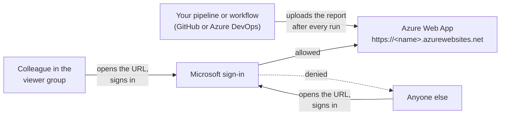

# Publish the report to an Azure Web App

After every run, your pipeline or workflow can upload the report to a website in Azure. Your colleagues open a URL and sign in with their normal Microsoft account - **only the members of one group can see the report**, everybody else is turned away.

This guide takes you through it step by step. Plan about 30 minutes.

**Before this guide:** your pipeline or workflow runs successfully - [GitHub](github.md) or [Azure DevOps](azure-devops.md).

## What you will end up with



| Component | What it is for |
|---|---|
| **Azure Web App** (with an App Service plan) | The website that shows the report. |
| **Sign-in for the web app** (an app registration in Microsoft Entra ID) | Makes everybody sign in before they see anything. |
| **Viewer group** (a security group in Microsoft Entra ID) | The people who may see the report. You manage access by adding or removing members. |
| **Managed identity** | Lets the sign-in work without a password. Nothing expires, nothing to renew. |
| **Your pipeline identity** | The account your pipeline or workflow already uses. It gets permission to upload to the web app. |

You don't have to create these one by one - a script does it for you (step 2).

The publish step of the pipeline ([pwsh/Publish-AzADSPIWebApp.ps1](../pwsh/Publish-AzADSPIWebApp.ps1)) checks the web app before every upload: it never publishes to a web app that can be opened without signing in.

## Before you start

### Question 1: Does your tenant have Microsoft Entra ID P1 or P2?

Check it: [Microsoft Entra admin center](https://entra.microsoft.com/) > **Overview** > field **License**.

| License | Your setting | What happens |
|---|---|---|
| **P1 or P2** | `Assignment` | Microsoft Entra only lets the group members sign in to the web app. |
| **Free** (or you are not sure) | `GroupClaim` | Everybody in your tenant can sign in, but the web app only shows the report to the group members. |

Both keep the report away from people outside the group. Good to know:

- With `Assignment`: put the users **directly** into the viewer group - a group inside the group doesn't count.
- With `GroupClaim`: users who are members of a very large number of groups (more than about 200) can be turned away although they are in the viewer group.

### Question 2: Who does the setup?

| Situation | Your path |
|---|---|
| **One person** has both roles: '**Cloud Application Administrator**' (or '**Application Administrator**') in Microsoft Entra ID **and** '**Owner**' of the Azure resource group | **Path A** - run one script, done |
| **Two teams**: an Entra admin and an Azure admin | **Path B** - the Entra admin and the Azure admin each do their part ([appendix](#path-b---two-teams-entra-admin-and-azure-admin)) |

## Step 1 - Prepare

Collect these values. You need them in the next steps.

| Value | Example | Where to find it |
|---|---|---|
| Tenant ID | `11111111-...` | Microsoft Entra admin center > **Overview** > **Tenant ID** |
| Subscription ID for the web app | `22222222-...` | Azure portal > **Subscriptions** |
| Resource group for the web app | `rg-azadspi` | Create one in the Azure portal if you don't have one yet |
| Web app name | `azadspi-contoso` | Your choice - it becomes the URL `https://azadspi-contoso.azurewebsites.net` and must be unique worldwide |
| Management group ID | `Contoso` | The same value your pipeline uses (`ManagementGroupId` in the variables file; several: comma separated; empty: the Tenant Root Group) |
| Object ID of the viewer group | `33333333-...` | Microsoft Entra admin center > **Groups** > your group > **Object ID**. Create a **security** group if you don't have one |
| Object ID of the pipeline identity | `44444444-...` | Microsoft Entra admin center > **Enterprise applications** > search the name of the identity your pipeline uses (step 2 of the [GitHub](github.md) or [Azure DevOps](azure-devops.md) guide; a managed identity: filter **Application type** = **Managed Identities**) > **Object ID** |
| Your setting from question 1 | `Assignment` or `GroupClaim` | |

> **Checkpoint 1:** all values are filled in, and the viewer group has at least one test user in it.

## Step 2 - Create the web app (path A)

Open PowerShell 7 in the folder of this repository and run the following - replace the values with yours from step 1:

```powershell
Connect-AzAccount -TenantId <Tenant ID>

./pwsh/New-AzADSPIWebApp.ps1 `
  -SubscriptionId <Subscription ID> `
  -ResourceGroupName <Resource group> `
  -WebAppName <Web app name> `
  -ManagementGroupId <Management group ID> `
  -AuthorizedGroupObjectId <Object ID of the viewer group> `
  -PublisherPrincipalObjectId <Object ID of the pipeline identity> `
  -AccessControl <Assignment or GroupClaim>
```

The script needs only the module `Az.Accounts` and takes a few minutes. You can run it again at any time - it reuses what exists and sets the web app back to its secure settings.

> **Checkpoint 2:** the script ends with a green line `Web app: https://<name>.azurewebsites.net`. Open that URL in a private browser window: you are sent to the **Microsoft sign-in page**. (After signing in you see an error page - that's expected, the report isn't there yet.)

## Step 3 - Connect your pipeline

Tell the pipeline where to upload the report:

| Variable | Value |
|---|---|
| `WebAppPublish` | `true` |
| `WebAppSubscriptionId` | the subscription ID from step 1 |
| `WebAppResourceGroup` | the resource group from step 1 |
| `WebAppName` | the web app name from step 1 |

- **GitHub:** in the `env` section of the workflow file (`AzADServicePrincipalInsights_OIDC.yml` or `AzADServicePrincipalInsights.yml` in `.github/workflows`)
- **Azure DevOps:** in `.azuredevops/pipelines/AzADServicePrincipalInsights.variables.yml`

Then run the pipeline or workflow.

> **Checkpoint 3:** in the run, the step **Publish HTML to WebApp** shows `Published '.../AzADServicePrincipalInsights_<management group ID>.html'`.

## Step 4 - Check who can see the report

1. A **member** of the viewer group opens the URL and signs in: they see the report.
1. Somebody who is **not** in the group opens the URL and signs in: they are turned away.
   - with `Assignment`: Microsoft shows a message that the user is not assigned to the application
   - with `GroupClaim`: the web app shows an "access denied" (403) page

The report loads its styling from azadvertizer.net, so the readers' browsers need access to it.

> **Checkpoint 4:** both tests behave as described - you're done. From now on, every run updates the report, and you manage who can see it by adding or removing members of the viewer group.

## If something doesn't work

| What you see | Why | What to do |
|---|---|---|
| Pipeline: `HTML NOT published - the WebApp (...) has no Authentication configured` (or `allows unauthenticated requests`, or `excludes paths from the authentication`) | The web app doesn't require a sign-in for the report. The pipeline never publishes to an open website. | Run the script from step 2 again. |
| Pipeline: `HTML NOT published (...) - RBAC Role 'Website Contributor' on the WebApp (...) is required` | The pipeline identity may not upload to the web app. | Run the script again with the right `-PublisherPrincipalObjectId` (step 1 explains where to find it). |
| Pipeline: `WebAppSubscriptionId '<subscriptionId>' - provide the Web App details (not the template placeholder)` | A `WebApp*` value still holds the placeholder. | Step 3. |
| Pipeline: `'...AzADServicePrincipalInsights_<ID>.html' not found` | The management group ID in the pipeline and the file name differ (also in upper/lower case). | Use exactly the same management group ID everywhere. |
| After signing in, the URL shows an error page instead of the report | The default document is a different report name: the script got another management group ID than the pipeline. | Run the script again with the `ManagementGroupId` of the pipeline. |
| A group member gets "not assigned to the application" (`Assignment`) | The user is only in a group *inside* the viewer group. | Add the user directly to the viewer group. |
| A group member gets "access denied" (`GroupClaim`) | The user is in very many groups. | Use `Assignment` if you have P1/P2, or ask your Entra admin about the user's group memberships. |
| Everybody gets an error right after signing in, code `AADSTS50011`, `AADSTS70021` or `AADSTS700213` | The sign-in of the web app is not finished (redirect URI, or the managed identity isn't connected to the app registration yet). | Path A: run the script again. Path B: check the last step of the Entra admin. |

## Path B - two teams (Entra admin and Azure admin)

Do the steps in this order - then the web app is never open to the whole tenant.

**1. Entra admin - create the sign-in** ([Microsoft Entra admin center](https://entra.microsoft.com/))

1. **App registrations** > **New registration**: name e.g. `AzADSPI-WebApp-<web app name>`, keep **Accounts in this organizational directory only** > **Register**
1. Note the **Application (client) ID** - the Azure admin needs it
1. **API permissions** > **Add a permission** > **Microsoft Graph** > **Delegated permissions**: `openid`, `profile`, `email`, `offline_access` > **Add permissions** > **Grant admin consent for _&lt;tenant&gt;_**
1. Access, depending on question 1:
   - `Assignment`: **Enterprise applications** > the same name > **Properties** > **Assignment required?** **Yes** > **Save**; then **Users and groups** > **Add user/group** > the viewer group > **Assign**
   - `GroupClaim`: back in the app registration: **Token configuration** > **Add groups claim** > **Security groups** > **Add**

**2. Azure admin - create the web app**, either

- with the script (step 2 above) plus `-SkipEntra -EntraClientId <Application (client) ID>` - it prints the values the Entra admin needs next, or
- with this button: [](https://portal.azure.com/#create/Microsoft.Template/uri/https%3A%2F%2Fraw.githubusercontent.com%2FJulianHayward%2FAzADServicePrincipalInsights%2Fmain%2Fsetup%2Fazure-web-app.json) - fill in the values from step 1, **Entra Client Id** = the Application (client) ID, **Access Control** = the same setting as the Entra admin used. The deployment's **Outputs** show the values the Entra admin needs next.

Tell the Entra admin the **redirect URI** (`https://<web app name>.azurewebsites.net/.auth/login/aad/callback`) and the name of the managed identity: `id-<web app name>-auth`.

**3. Entra admin - finish the sign-in**

1. App registration > **Authentication** > **Add a platform** > **Web** > the redirect URI > **Configure**
1. App registration > **Certificates & secrets** > **Federated credentials** > **Add credential**
1. Scenario **Managed identity** > select the managed identity `id-<web app name>-auth` > give it a name > **Add**

Then continue with [checkpoint 2](#step-2---create-the-web-app-path-a).

<details>
<summary><b>Technical details</b> - what exactly gets created</summary>

- **Microsoft Entra ID:** app registration (single tenant, redirect URI `/.auth/login/aad/callback`, delegated Microsoft Graph permissions `openid profile email offline_access` with admin consent) and its enterprise application. `Assignment`: `appRoleAssignmentRequired` and the group assigned (default app role). `GroupClaim`: `groupMembershipClaims: SecurityGroup`. Federated identity credential: issuer `https://login.microsoftonline.com/<tenant>/v2.0`, subject = principal ID of the managed identity, audience `api://AzureADTokenExchange`.
- **Azure:** user-assigned managed identity `id-<name>-auth` (only for the sign-in - don't assign it to anything else), App Service plan `asp-<name>` (Windows, default SKU B1; `-Sku F1` is free but without SLA), web app `<name>`: HTTPS only, TLS 1.2, FTP disabled, basic authentication (FTP and SCM) disabled, default document `AzADServicePrincipalInsights_<management group ID>.html` (several management groups: joined by `_`; the Tenant Root Group: the tenant ID).
- **App Service Authentication (v2):** Microsoft Entra, login required (redirect to the sign-in page), client assertion by the managed identity (app setting `OVERRIDE_USE_MI_FIC_ASSERTION_CLIENTID`, no client secret), allowed tenant = your tenant. `GroupClaim`: `jwtClaimChecks.allowedGroups` and `defaultAuthorizationPolicy.allowedPrincipals.groups` = the viewer group.
- **Role:** '**Website Contributor**' on the web app for the pipeline identity. The publish step uploads with a Microsoft Entra token - basic authentication is not needed.
- **Script and template:** [pwsh/New-AzADSPIWebApp.ps1](../pwsh/New-AzADSPIWebApp.ps1) (REST calls, needs only the module `Az.Accounts`; the endpoints follow the cloud of your Azure context) and the ARM template [setup/azure-web-app.json](azure-web-app.json) create the same Azure resources.
- **Switching** from `Assignment` to `GroupClaim` later: run the script with the new setting and set **Assignment required?** of the enterprise application back to **No**.
- **An existing web app** that you set up yourself: the publish step works with any web app that requires a sign-in (App Service Authentication, **Require authentication**) and gives the pipeline identity '**Website Contributor**'.

</details>
