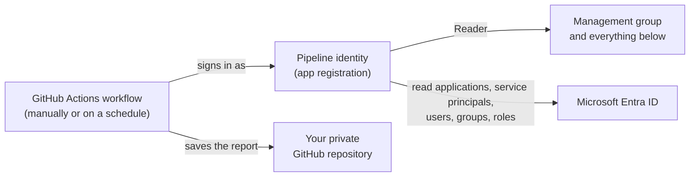

# Run AzADServicePrincipalInsights from GitHub

A GitHub Actions workflow runs AzADServicePrincipalInsights - manually or on a schedule - and saves the report in your repository. The workflow signs in with an app registration that only gets read access.

## What you will end up with



| Component | What it is for |
|---|---|
| **GitHub repository** (private) | Holds the code, the workflow and the report. |
| **Pipeline identity** (an app registration in Microsoft Entra ID) | The account the workflow runs as. It gets read access only. |
| **Repository secrets** | Tell the workflow which app registration to sign in as. |
| **Workflow** | Runs AzADServicePrincipalInsights and saves the report, the CSV and JSON files and the change history in the repository. |

## Before you start

The Microsoft Entra steps are described in the [Azure portal](https://portal.azure.com) (**Microsoft Entra ID**). The [Microsoft Entra admin center](https://entra.microsoft.com/) has the same pages, if you prefer it.

### Who you need

| Steps | Role |
|---|---|
| 1, 4 | Permission to create a repository in your GitHub organization |
| 2 | Permission to create app registrations in Microsoft Entra ID, and '**Owner**' or '**User Access Administrator**' of the management group - for the '**Reader**' role assignment |
| 3 | '**Privileged Role Administrator**' or '**Global Administrator**' in Microsoft Entra ID |

### Choose how the workflow signs in

| Option | Workflow file | |
|---|---|---|
| **Option A** - federated credential (recommended) | `.github/workflows/AzADServicePrincipalInsights_OIDC.yml` | No secret to store or renew. |
| **Option B** - client secret | `.github/workflows/AzADServicePrincipalInsights.yml` | The secret expires - you must renew it. |

## Step 1 - Create a private repository with the code

1. Open <https://github.com/new/import>
1. Clone URL: `https://github.com/JulianHayward/AzADServicePrincipalInsights.git`
1. Owner: your GitHub organization; a repository name; visibility **Private** > **Begin import**

The report contains insights about your tenant - the workflow stops when the repository is public.

> **Checkpoint 1:** the repository is private and contains the files of AzADServicePrincipalInsights.

## Step 2 - Create the pipeline identity

Note the **management group ID** first: Azure portal > **Management groups** > your management group (usually the **Tenant Root Group**) > **ID** on the overview page - not the display name.

**1. Create the app registration**

1. [Azure portal](https://portal.azure.com) > **Microsoft Entra ID** > **App registrations** > **New registration**
1. Name, e.g. `AzADServicePrincipalInsights_GitHub`; keep **Accounts in this organizational directory only** > **Register**
1. Note the **Application (client) ID** and the **Directory (tenant) ID**

**2. Let GitHub sign in as the app registration**

- **Option A:** in the app registration > **Certificates & secrets** > **Federated credentials** > **Add credential**
  1. Scenario **GitHub Actions deploying Azure resources**
  1. **Organization** and **Organization ID**: the owner of the repository - your GitHub organization (or your user name, for a repository of your personal account) and its number
  1. **Repository** and **Repository ID**: your repository name and its number
  1. **Entity type**: **Branch**; **GitHub branch name**: `main` (the default branch of the imported repository)
  1. **Subject identifier** now shows `repo:<organization>@<organization ID>/<repository>@<repository ID>:ref:refs/heads/main`
  1. A name, e.g. `AzADServicePrincipalInsights_GitHub` > **Add**

  **Finding the two IDs** - take both from the repository itself, then they belong to it for sure:
  - GitHub CLI (first the organization ID, then the repository ID): `gh api repos/<organization>/<repository> --jq '.owner.id, .id'`
  - Browser: signed in to GitHub, open the repository > **View page source** > search for `octolytics-dimension`: `user_id` is the organization ID (also for an organization), `repository_id` the repository ID

  Looking up the organization ID by name (`https://api.github.com/orgs/<organization>`, for a personal account `https://api.github.com/users/<user name>`) works too - but check the name: a similarly named account has a different ID, and the sign-in fails.

  Why the IDs: GitHub puts them into the token of repositories created after July 15, 2026 - your imported repository is one of them ([immutable subject](https://learn.microsoft.com/entra/workload-id/workload-identities-github-immutable-subjects)). Only runs of that branch of exactly this repository can sign in; a renamed or newly created repository with the same name can't. The report's section 'Federated identity credentials' shows this trust.
- **Option B:** in the app registration > **Certificates & secrets** > **Client secrets** > **New client secret** > a description and an expiry > **Add**. Copy the **Value** now - it is shown only once.

**3. Give it the '**Reader**' role**

[Azure portal](https://portal.azure.com) > **Management groups** > your management group > **Access control (IAM)** > **Add** > **Add role assignment** > '**Reader**' > **Next** > **Select members** > the app registration > **Review + assign**

**4. Store the sign-in details in GitHub**

Your repository > **Settings** > **Secrets and variables** > **Actions** > **New repository secret**:

| Option A - three secrets | Option B - one secret |
|---|---|
| `CLIENT_ID`: the Application (client) ID<br/>`TENANT_ID`: the Directory (tenant) ID<br/>`SUBSCRIPTION_ID`: the ID of any subscription in the management group | `CREDS`: the JSON below |

```json
{
  "tenantId": "<Directory (tenant) ID>",
  "subscriptionId": "<ID of any subscription in the management group>",
  "clientId": "<Application (client) ID>",
  "clientSecret": "<client secret value>"
}
```

> **Checkpoint 2:** the app registration has '**Reader**' on the management group, and the secrets are stored in the repository.

## Step 3 - Allow the pipeline identity to read Microsoft Entra ID

The app registration needs four Microsoft Graph permissions. A '**Privileged Role Administrator**' or '**Global Administrator**' grants them:

1. [Azure portal](https://portal.azure.com) > **Microsoft Entra ID** > **App registrations** > **All applications** > your app registration
1. **API permissions** > **Add a permission** > **Microsoft Graph** > **Application permissions**
1. Select `Application.Read.All`, `Group.Read.All`, `RoleManagement.Read.Directory` and `User.Read.All` > **Add permissions**
1. **Grant admin consent for _&lt;tenant&gt;_** > **Yes**

More data with [optional permissions](README.md#microsoft-graph) - grant them the same way. `DelegatedPermissionGrant.Read.All` makes the run faster.

> **Checkpoint 3:** **API permissions** shows the permissions with the status **Granted for _&lt;tenant&gt;_**.

## Step 4 - Set the variables and run the workflow

**1. Set the variables**

In your repository, edit `.github/AzADServicePrincipalInsights.variables.yml`:

- `ManagementGroupId`: replace `<YourManagementGroupId>` with your management group ID (exact upper and lower case). Several: comma separated.
- All other variables are optional and explained in the file. The optional features have their own sections at the end, each with its switch first ([Log Analytics](log-analytics.md), [Web App](azure-web-app.md)).

Commit the change.

**2. Run the workflow**

1. **Actions** - if GitHub asks, enable the workflows
1. Select **AzADServicePrincipalInsights_OIDC** (option A) or **AzADServicePrincipalInsights** (option B) > **Run workflow** > **Run workflow**

> **Checkpoint 4:** the run succeeds, and the repository contains the folder `wiki` with the report `AzADServicePrincipalInsights_<management group ID>.html` - you're done. Download it and open it in a browser.

**3. Optional: run it on a schedule**

In the workflow file (`AzADServicePrincipalInsights_OIDC.yml` or `AzADServicePrincipalInsights.yml` in `.github/workflows`), remove the `#` in front of `schedule:` and the `- cron:` line below it. The example runs twice a day; GitHub uses UTC.

Runs of the same branch wait for each other: they change the same files. A manual run during a scheduled one starts when the scheduled one has saved its output.

## If something doesn't work

| What you see in the workflow run | Why | What to do |
|---|---|---|
| Step **Create arguments**: `Variable 'ManagementGroupId' = '<YourManagementGroupId>' - provide the value ...` | The variables file still holds the placeholder. | Step 4, part 1. |
| Step **Check prerequisites**: `Repository '...' is accessible from the public ...` | The report would be readable by anyone. | Make the repository private. |
| Step **Connect Azure OIDC** fails with `AADSTS700213: No matching federated identity record found` | The federated credential doesn't match the repository or branch - or the IDs: a repository created after July 15, 2026 sends `repo:<organization>@<ID>/<repository>@<ID>:...`, an older one `repo:<organization>/<repository>:...` (unless switched to the new format in its OIDC settings). | The error message shows the subject GitHub sent (`... for presented assertion subject 'repo:...'`): compare it character by character with the **Subject identifier** of the credential (step 2, part 2) - names, both IDs, branch. |
| Step **Connect Azure** / **Connect Azure OIDC** fails with an error about the subscription | The subscription in the secrets is not in the management group, or the '**Reader**' role is missing. | Step 2, parts 3 and 4. |
| `MG '<ID>' Reader permission check FAILED` | No '**Reader**' on the management group, or `ManagementGroupId` holds the display name. | Step 2, part 3; step 4. |
| `AAD ... Read permission check FAILED - the Microsoft Graph application permission ... is missing` | The message names the Microsoft Graph permission that is missing - not added, added as **Delegated** instead of **Application**, or without admin consent. | Step 3: **API permissions** must show it with type **Application** and status **Granted for <tenant>**. |
| Step **Script directory**: `Variable 'ScriptDir' in '...' = '...' - the folder of the AzADServicePrincipalInsights scripts` | `ScriptDir` in the variables file doesn't name the folder with the scripts. | Set it to the folder, relative to the repository root (default `pwsh`). |
| Step **Push AzADServicePrincipalInsights output to repository** fails with `403` | The workflow may not write to the branch (a branch protection rule, or your organization limits the workflow token). | Allow the push: **Settings** > **Branches**, or **Settings** > **Actions** > **General** > **Workflow permissions**. |
| `git pull --rebase ... failed: another run changed the same output files at the same time` | Two runs overlapped. | Run it again. |
| Option B: the sign-in fails with `AADSTS7000222` | The client secret has expired. | Create a new client secret and update `CREDS` - or switch to option A. |

## Updating

Pull the new version from the upstream repository into your copy:

```bash
git remote add upstream https://github.com/JulianHayward/AzADServicePrincipalInsights.git
git fetch upstream
git merge upstream/main
```

Your variables file and output folder may conflict: keep your values. The [changelog](../CHANGELOG.md) lists new parameters.

## Next steps

- Share the report with a group of colleagues on a website: [Publish the report to an Azure Web App](azure-web-app.md).
- Query and alert on the data: [Send the output to Log Analytics](log-analytics.md).
- Change what the report contains: the variables in `.github/AzADServicePrincipalInsights.variables.yml` ([parameters](../README.md#parameters)).
