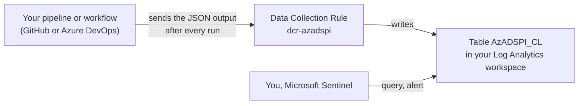

# Send the output to Log Analytics

After every run, your pipeline or workflow can send the JSON output to a Log Analytics table: one record per service principal, application or managed identity. Then you can query and alert on it in Log Analytics or Microsoft Sentinel. Background: [Microsoft Entra Workload ID - Advanced Detections and Enrichment in Microsoft Sentinel](https://www.cloud-architekt.net/entra-workload-id-advanced-detection-enrichment/) (Thomas Naunheim).

**Before this guide:** your pipeline or workflow runs successfully - [GitHub](github.md) or [Azure DevOps](azure-devops.md).

## What you will end up with



| Component | What it is for |
|---|---|
| **Table** `AzADSPI_CL` | One column per top-level property of the JSON output. |
| **Data Collection Rule** `dcr-azadspi` | Receives the records (stream `Custom-AzADSPI_CL`) and writes them to the table. Kind `Direct`: it has its own logs ingestion endpoint, no Data Collection Endpoint needed. |
| **Your pipeline identity** | The account your pipeline or workflow already uses. It gets permission to send to the Data Collection Rule ('**Monitoring Metrics Publisher**'). |

A template creates all of it (step 1). The sending step ([pwsh/Send-AzADSPILogAnalyticsData.ps1](../pwsh/Send-AzADSPILogAnalyticsData.ps1)) runs after the output was saved in the repository: if it fails, the report and the change history are saved anyway.

## Before you start

### Who you need

| Steps | Role |
|---|---|
| 1 | '**Contributor**' or '**Owner**' of the resource group of the Log Analytics workspace |
| 1 (with `principalId`) or 2 | '**Owner**', '**User Access Administrator**' or '**Role Based Access Control Administrator**' of the resource group - for the role assignment |
| 3 | Permission to change the variables file of your pipeline or workflow |

You need a Log Analytics workspace. Use an existing one, or [create one](https://learn.microsoft.com/azure/azure-monitor/logs/quick-create-workspace).

Note the **object ID** of your pipeline identity: [Microsoft Entra admin center](https://entra.microsoft.com/) > **Enterprise applications** > your pipeline identity (a managed identity: filter **Application type** = **Managed Identities**) > **Object ID** - not the application ID.

## Step 1 - Deploy the table and the Data Collection Rule

Deploy the template [log-analytics-dcr.json](log-analytics-dcr.json) into the **resource group of the Log Analytics workspace**. Parameters:

| Parameter | Default | Value |
|---|---|---|
| `workspaceName` | | the name of the workspace |
| `tableName` | `AzADSPI_CL` | the name of the table, ending with `_CL` |
| `dataCollectionRuleName` | `dcr-azadspi` | the name of the Data Collection Rule |
| `location` | region of the resource group | the region of the workspace |
| `principalId` | empty | optional: the object ID of your pipeline identity. It gets '**Monitoring Metrics Publisher**' on the Data Collection Rule. Leave it empty if you may not assign roles - then step 2. |

Choose one way:

- **Azure portal** - the template of the `main` branch:

  [](https://portal.azure.com/#create/Microsoft.Template/uri/https%3A%2F%2Fraw.githubusercontent.com%2FJulianHayward%2FAzADServicePrincipalInsights%2Fmain%2Fsetup%2Flog-analytics-dcr.json)

  Select the subscription and the resource group of the workspace, fill in the parameters > **Review + create** > **Create**. The button works for the Azure public cloud. For Azure Government or Azure operated by 21Vianet, or for your own copy of the template: search the portal for **Deploy a custom template** > **Build your own template in the editor**, paste the content of [log-analytics-dcr.json](log-analytics-dcr.json) > **Save**.

- **Azure PowerShell:**

  ```powershell
  New-AzResourceGroupDeployment -ResourceGroupName <resource group of the workspace> -TemplateFile ./setup/log-analytics-dcr.json -workspaceName <workspace name> -principalId <object ID>
  ```

- **Azure CLI:**

  ```bash
  az deployment group create --resource-group <resource group of the workspace> --template-file setup/log-analytics-dcr.json --parameters workspaceName=<workspace name> principalId=<object ID>
  ```

The template has a column for every property the script writes (a test makes sure of it). If a new version adds JSON properties ([changelog](../CHANGELOG.md)), deploy the template of that version again: that adds the new columns.

> **Checkpoint 1:** the workspace > **Tables** lists `AzADSPI_CL`, and **Monitor** > **Data Collection Rules** lists `dcr-azadspi`.

### Without the template

Create the table and the Data Collection Rule with the columns of the template (`variables.columns`). `TimeGenerated` is datetime; `RunId`, `ObjectId`, `ObjectType` and `AgentType` are string; all other columns are dynamic. The stream of the rule is `Custom-<table name>`, with the transformation `source` and the same columns.

Don't create the table from one sample JSON file (portal: **New custom log (DCR-based)** > sample file). No output file contains all properties - for example, a managed identity has no `APP*` properties and an application has no `ManagedIdentity*` properties. The missing columns would be dropped for every record, without an error.

## Step 2 - Allow your pipeline identity to send

Skip this step if you passed `principalId` in step 1.

[Azure portal](https://portal.azure.com) > **Monitor** > **Data Collection Rules** > `dcr-azadspi` > **Access control (IAM)** > **Add** > **Add role assignment** > '**Monitoring Metrics Publisher**' > **Next** > **Select members** > your pipeline identity > **Review + assign**

> **Checkpoint 2:** **Access control (IAM)** > **Role assignments** of the Data Collection Rule lists '**Monitoring Metrics Publisher**' for your pipeline identity.

## Step 3 - Turn it on

**1. Tell the pipeline where to send**

In the variables file, section 'Log Analytics ingestion' - GitHub: `.github/AzADServicePrincipalInsights.variables.yml`; Azure DevOps: `.azuredevops/pipelines/AzADServicePrincipalInsights.variables.yml`:

| Variable | Value |
|---|---|
| `DataCollectionRuleSubscriptionId` | the subscription of the Data Collection Rule |
| `DataCollectionRuleResourceGroup` | the resource group of the Data Collection Rule |
| `DataCollectionRuleName` | `dcr-azadspi` (or your name) |
| `LogAnalyticsCustomLogTableName` | `AzADSPI_CL` (or your name, with `_CL`) |

`ThrottleLimitMonitor` and `MaxRequestBytes` are optional. Don't set `NoJsonExport` - the JSON output is what gets sent.

**2. Switch it on**

- **GitHub:** `IngestToLogAnalytics: true` in the `env` section of the workflow file
- **Azure DevOps:** `IngestToLogAnalytics` = `true` in the variables file

Then run the pipeline or workflow.

> **Checkpoint 3:** in the run, the step **Upload data to Log Analytics via Logs ingestion API** shows `Ingested <n> of <n> records in <m> requests`.

## Step 4 - Query the data

The first records of a new table can take several minutes to appear. Then, in the workspace > **Logs**:

```kusto
AzADSPI_CL
| where TimeGenerated > ago(1d)
| summarize arg_max(TimeGenerated, *) by ObjectId
| where tostring(SPEffectivePrivilege.level) == 'critical'
| project TimeGenerated, ObjectType, DisplayName = tostring(SP[0].SPDisplayName), Reasons = SPEffectivePrivilege.reasons
```

All records of a run share the same `RunId` (the start time of the sending step, `yyyyMMddHHmmss` UTC).

> **Checkpoint 4:** `AzADSPI_CL | summarize count() by RunId` shows one row per run - you're done.

## If something doesn't work

| What you see in the step **Upload data to Log Analytics via Logs ingestion API** | Why | What to do |
|---|---|---|
| Step **Create arguments**: `Variable 'DataCollectionRuleName' = '<...>' - provide the value ...` | The variables file still holds a placeholder. | Step 3, part 1. |
| `ImportPath '...' does not exist - the ingestion needs the JSON export ...` | `NoJsonExport` is set. | Remove `NoJsonExport` from the variables file. |
| `Data Collection Rule '...' has neither a logs ingestion endpoint nor a Data Collection Endpoint` | The rule was created without the template and without a Data Collection Endpoint. | Step 1 (template). |
| `failed: ...` lines with `403` / `Forbidden`, then `... ingestion requests or files failed` | Your pipeline identity may not send to the Data Collection Rule, or the role assignment is not active yet. | Step 2. A new role assignment can take a while to work - run it again later. |
| `Skipping ...: ... KB exceeds the maximum request size` | One record is larger than `MaxRequestBytes`. | See [Limits](#limits). The other records are sent. |
| The run succeeded, but some columns stay empty | The table or the Data Collection Rule misses columns (e.g. created from a sample file). | Step 1: deploy the template - it adds the missing columns. |

## Limits

- **Record size:** one request to the Logs Ingestion API is at most 1 MB. A record (the compressed JSON of one object) larger than `MaxRequestBytes` (default 900 KB) is skipped. The step lists the skipped records in a warning, and the run continues. In a test tenant, the largest record (the Microsoft Graph service principal) was about 800 KB.
- **Large values:** dynamic columns keep large values complete. In a test (2026-11-10), values up to 785 KB (`SP` of Microsoft Graph, `SPAzureRoleAssignments` of a service principal with many role assignments) arrived complete.
- **Columns:** only properties with a column in the table and in the stream of the Data Collection Rule are stored. The template has all of them; see [Without the template](#without-the-template).
